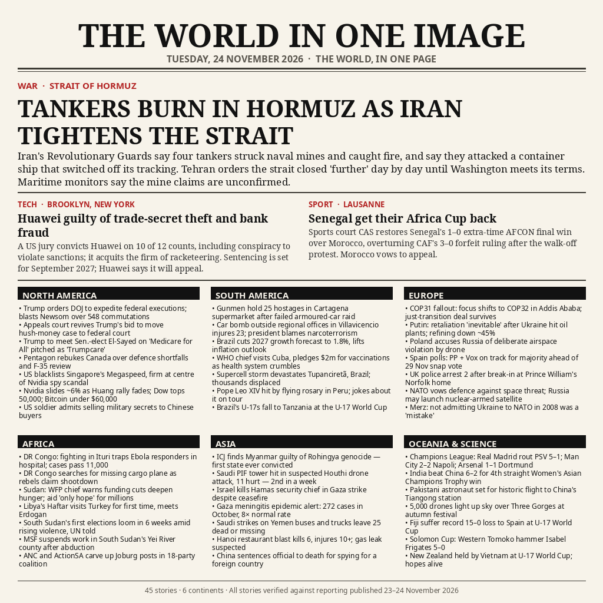

# nov24-world-news-image

[](https://make.fun/bounty/news-image-20261124?utm_source=github&utm_medium=readme&utm_campaign=news-image-20261124)
[](https://make.fun/bounty/news-image-20261124/leaderboard?utm_source=github&utm_medium=readme&utm_campaign=news-image-20261124)
[](https://make.fun/bounty/news-image-20261124?utm_source=github&utm_medium=readme&utm_campaign=news-image-20261124)

One image summing up Tuesday 24 November 2026's world news: a newspaper front page with **45 stories across 6 continents**, led by tankers burning in the Strait of Hormuz as Iran tightens the strait, the Huawei guilty verdict in Brooklyn, and Senegal regaining their Africa Cup of Nations title at the sports court. Every story was verified against reporting published 23–24 November 2026 (see `stories.json` for the full list and sources).



## Run it

```sh
python3 render.py
```

Regenerates `entry.png` (1024×1024) from `stories.json` with Python and Pillow — no network calls, no external assets, Noto fonts only.

## Files

- `entry.png` — the submitted image
- `stories.json` — the 45 verified stories, lead + second leads, grouped by continent
- `render.py` — the renderer that draws the front page

---

<sub>Entered on [make.fun](https://make.fun/bounty/news-image-20261124) as @thucthai7814.</sub>
